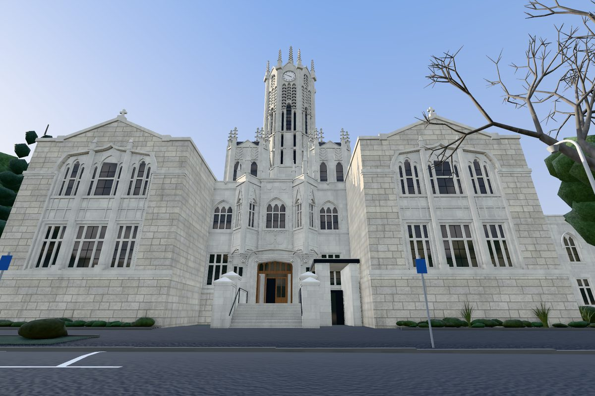

# Landmark: the Clock Tower, drawn from code

The University of Auckland Clock Tower (building 105) drawn in three.js from code alone, sized by the
LINZ 2024 LiDAR and checked against Street View photographs, by a lead agent and five agents in
parallel (October 2026). The kit it is built with, the pipeline, the viewer and how to run them are
shared by every landmark: [`../README.md`](../README.md).

- Look at it: `http://localhost:8765/landmarks/pipeline/viewer/index.html?landmark=clocktower&view=orbit`
  with the repository root served on port 8765. On the site it stands in place of the blocks of
  building 105 and of its south range, 105S ("The Clock Tower South Wing" on the campus map), when
  the camera comes near: [`../README.md`](../README.md), "On the site".
- Run its pipeline: `landmarks/pipeline/run.sh clocktower [stage ...]`.
- The rules the agents worked to: [`docs/CONTRACT.md`](docs/CONTRACT.md) and
  [`docs/ART_BIBLE.md`](docs/ART_BIBLE.md).

| File | What it is |
| --- | --- |
| `model.js` | assembles the parts: `pavilions`, `centre`, `tower`, `ranges` |
| `parts/` | one file per part, plus `common.js` (the sizes every part shares) and the parts' own kits (`tower_kit.js`, `centre_kit.js`) |
| `landscape.js` | Princes St, the forecourt, the planting and 60 trees from the LiDAR, for the viewer |
| `config/clocktower.json` | the buildings it draws (105, and 105S in `also`), the LiDAR and aerial tiles, the frame, the door, the 12 Street View panoramas, the refinement bounds |
| `placement.json` | where it stands on the campus map, and the blocks it stands in place of (written by the `place` stage) |

## The frame

- View frame: x to the right as seen from Princes St, y up from the ground at the door (45.8 m
  NZVD2016), z toward the street, the tower's centre at x = z = 0.
- In the LiDAR frame (local NZTM metres): the tower's centre is at (35.196, 228.507), and the facade
  axis points at bearing 19.0° (grid). So x runs at 199° and the front faces 289°.
- On the map (`placement.json`): the centre is at (30.960, 229.141), 4.2 m west of the LiDAR frame's
  numbers. x runs at 197.94° and z at 287.94° (true). The door, at the foot of the entrance steps,
  is at (14.60, 235.44).
- Building 105's outline in `campus.json` is in the map's frame. Put into the view frame through the
  map, it agrees with the LiDAR to within about 1 m: the pavilion fronts at z 16.2–17.7 (LiDAR
  17.1–17.9), the centre's wall at 10.6–11.2 (10.8), the back at -16.5 to -18.1 (-17.8). Read as if
  it were in the LiDAR frame, it stands 3.9–5.2 m off.
- Seen from above on the map (0.5 m grid, 2026-10-21), the model covers 95% of building 105's block
  and 94% of 105S's, and 0.3% of 119's (the East Wing, which it touches). So it stands in place of
  105 and 105S.
- On the map it stands on the ground it shares with the East Wing, whose outline it touches (since
  2026-11-03; `standHeights` in `src/scene/landmarks.ts`, `../README.md`, "Placement"): its y = 0 at the
  door's LiDAR ground, 45.8 m, plus the two landmarks' mean of the map's ground at the door minus the
  LiDAR's, -2.312 m, so at 43.488 m, 2.534 m higher than the map's ground at its own door (40.954 m), and
  the two stand at the LiDAR's heights against each other. The map's ground lies 2.27 to 3.12 m below
  y = 0 all round it (0.59 m below to 0.26 m above before), so everything the parts draw below the
  door's level goes 2.6 m lower (`FOOT` in `parts/common.js`, `carryDown` in `model.js`): the walls'
  feet to -2.6 and -3.0 m and the steps' to -2.6 m. On the site 2.3 to 3.1 m of its walls, and of the
  steps' base, show below the door's level.

## Round 1 (October 2026)

Silhouette IoU against the refined front views: whole front 0.68–0.72, tower 0.89–0.95, door
0.88–0.98; the building's luma median within about 5 of the photographs. About 129k triangles in 9
draw calls for the building, and 125k for the street and trees. Eight panoramas (backlit, behind
trees, or the back) could not be refined and still match poorly (IoU 0.06–0.5). How the round was
run: the skill's `METHOD.md`.
