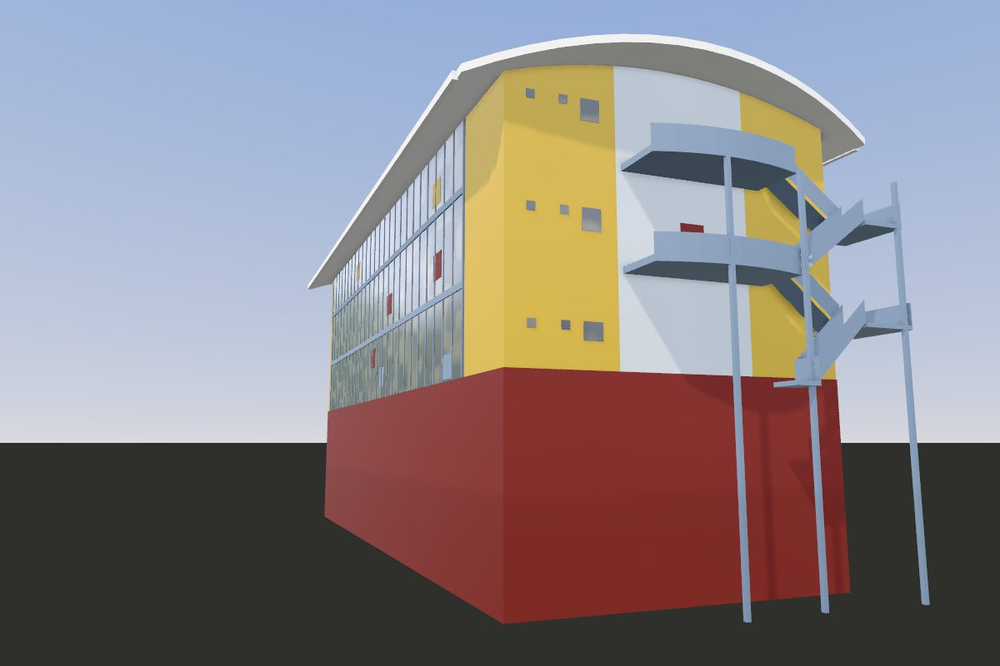
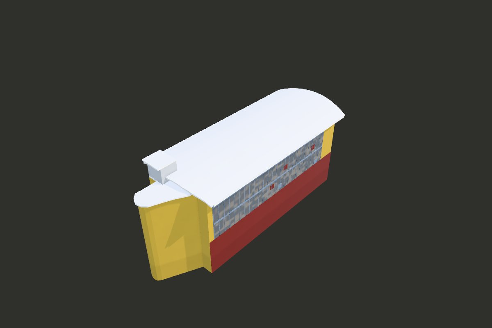
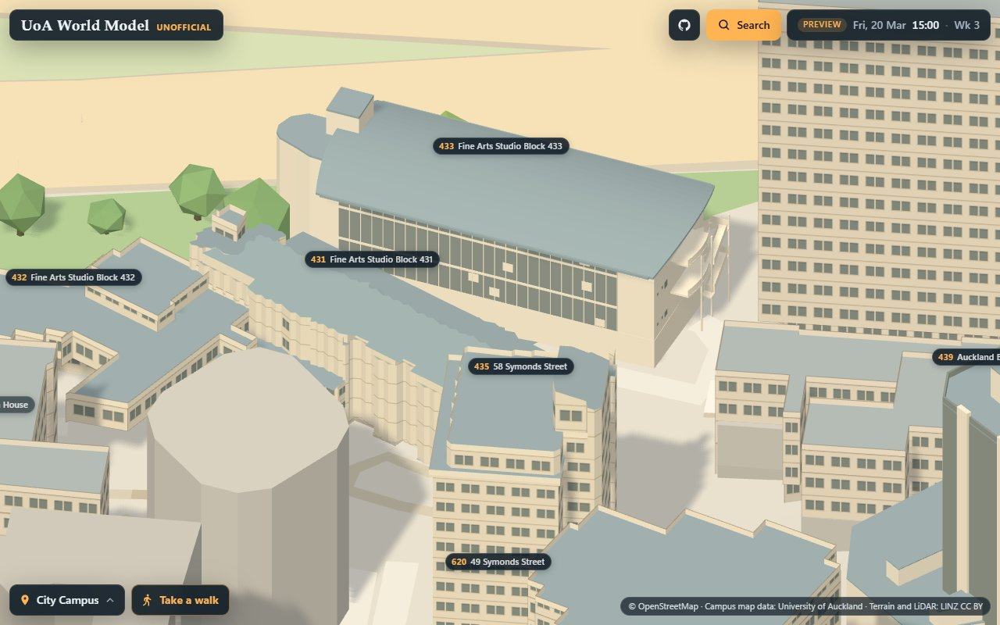
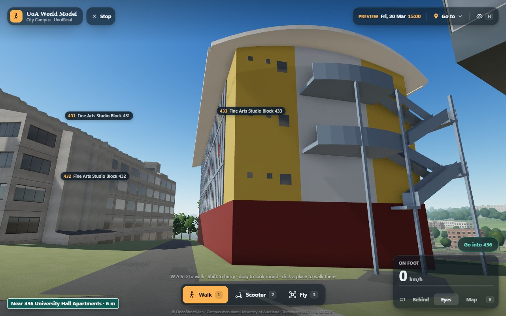

# Landmark: Fine Arts Studio Block 433, drawn from code

Fine Arts Studio Block 433 of the University of Auckland, on the City campus: a long block of four storeys under a
shallow vault whose ends bow out, its north-west face a wall of glazing over a red ground storey on the lane it shares
with 431, its west-south-west end clad in yellow weatherboards, with two balconies and an outside stair, and at its
east-north-east end a lower block rounded in plan. It is drawn in three.js from code alone, sized by the LINZ 2024
LiDAR, and compared with a photograph of its north-west face and its west-south-west end (November 2026). Until now it
was a measured massing (`../MASSING.md`). The kit it is built with, the pipeline, the viewer and how to run them are
shared by every landmark: [`../README.md`](../README.md).

- Look at it: `http://localhost:8765/landmarks/pipeline/viewer/index.html?landmark=fine-arts-studio-block-433&view=orbit`
  with the repository root served on port 8765.
- Run its pipeline: `landmarks/pipeline/run.sh fine-arts-studio-block-433 [stage ...]`. Its reference is read from
  `refs/photos/` (the config's `"refs": "photos"`), which a fresh clone does not have: `photo`, `refs` (its masks, and
  so the default `all`), `refine`, `compare` and `metrics` need it, `data`, `place` and `topview` do not.
- The rules: [`docs/CONTRACT.md`](docs/CONTRACT.md) and [`docs/ART_BIBLE.md`](docs/ART_BIBLE.md).

## In brief

This is Fine Arts Studio Block 433, on the City campus, until now a measured massing: a long block of four
storeys under a shallow vault whose ends bow out, its face to the lane it shares with 431 a wall of glazing, most of
its panes frosted and some red, yellow or blue, over a dark red ground storey; its west-south-west end clad in yellow
weatherboards, with a grey bay, two balconies with bowed fronts and an outside stair beside them; at its
east-north-east end a lower block rounded in plan. Its heights and plans come from the LiDAR but for the end wall's
place and the red ground storey's height; those, the glazing's mullions, floor bands and panels, the doors and
windows, the balconies' fronts and the stair are estimated with the photograph as a reference. One photograph from the road at the block's west-south-west end, looking along the face to the lane and at
the end; counted inside the rectangle the model fills on the screen, its silhouette has an IoU of 0.92 in it, and the
brightness over it is within 4 of the photograph's. From above its outline covers the LiDAR's with an IoU of 0.94,
and on 99% of the cells both cover it is within 0.5 m of the LiDAR's height. What the photograph does not show is
drawn plainly.

| | |
| --- | --- |
|  |  |
|  |  |

## The frame

`config/fine-arts-studio-block-433.json`, `frame`: x west-south-west (minus the axis, the bearing of the long walls),
y up from 33.1 m NZVD2016, the LiDAR's ground at `door`, on the lane before the north-west face, z north-north-west,
toward the lane; the centre, the mean of the building's returns near the campus map's ring (the lower block at the
east-north-east end among them), at x = z = 0. `parts/common.js` gives the building a frame of its own: `u`
east-north-east (minus x) and `w` north-north-west (z).

The frame was measured above 32.6 m, the median ground in the outline's band, as the measured massing took it; its
thresholds in the config were lowered by the 0.5 m to the door's ground, and `frame.expected` checks the centre and
the axis (0.000 m, 0.000 degrees). The crop box reaches 35 m past the ring, so that the LiDAR's ground under the
photograph's camera is in it.

## Neighbours on the map

- No other landmark's outline comes within 2 m of its (the nearest, Auckland Bioengineering House's, is about 60 m
  off), so it stands alone on the map's ground at its door (`../README.md`, "Placement").
- Block 431 is across the lane to the north-west, block 432 beyond the east-north-east end and University Hall's
  (436) beyond the road at the west-south-west end; the model stands over 97.0% of block 433 and over none of theirs.
  `building.also` is empty.

## The reference

One photograph, kept on the maintainer's computer in `refs/photos/` (gitignored), with its picks, its fitted camera,
its level cut and its mask. Nothing of it goes into git, and how it is recorded and credited is for the maintainer to
decide. It has no record of its date. No Street View photograph is used.

- **The north-west face and the west-south-west end**, from the road at the block's west-south-west end, under an
  overcast sky: the face receding to the east-north-east with the lane before it, the end with its balconies and
  stair, the vault's curved edge against the sky; a smaller picture laid over its bottom right, left out of the fit and
  the masks. Its camera is fitted by `tools/photo_camera.py` to lines and points whose places the LiDAR gives: the
  north-west eave against the sky, the face's foot on the lane (33.05 m), the eave's far end, the vault's south corner
  at the end, and four uprights (the west corner, a downpipe at the north corner, two of the stair's posts). It stands
  1.8 m over the LiDAR's ground about 25 m west-south-west of the end and 9 m out from the line of the north-west face,
  through a lens of 47 degrees across, its optical axis at bearing 86 degrees: an rms of 0.87 px. That place is 2 to 3
  m inside the edge of the LiDAR's returns on the roof of the building beyond the road (48 m): the photographer stood
  at that edge, under its eave, or the fit is that far off. From other starts it comes back to the same place; without
  the face's foot it stands 1.1 m further back, and with its principal point solved as well 3.9 m further back.

No size is measured from the photograph but the ones the next section names as estimated; it is a reference for the
look and the comparison.

## The model (`parts/common.js`)

- **The main block** (`claddingYellow`): its long walls where the LiDAR's returns under the eave peak (w 8.25 and
  -8.25), its east-north-east end wall at u 20.1 (its returns at 20.0 to 20.5), its west-south-west end wall at u -24.5
  (estimated, through the photograph's camera: the LiDAR sees the balconies and the stair before it), down to the
  walls' foot; the end walls rise to the vault.
- **The vault** (`roofPale`, light grey as the 2023 aerial shows it): its top a parabola across the faces, 51.9 m at the
  crown and 2.05 m lower at w 10.15 (the LiDAR's returns, p50 in 1 m strips); its eaves at w 10.3 and its ends bowed out
  in plan: at the west-south-west end from u -25.2 at the eaves to -26.8 at the crown, 0.15 to 0.2 m out from the
  returns' least u (their spacing); at the east-north-east end along the greatest u of the returns on the vault (the
  lower block's roof and the plant room left out), 0.15 m out, from 20.85 at the eaves to 22.5 at the crown; 0.35 m
  thick, with a gutter along each eave (estimated).
- **The east-north-east end**: the lower block at 50.5 m, its roof to its returns' edge (its south side at w -4.85 to
  u 23.45, then at -2.3, rounded to u 30.3, its north side along its returns from w 5.59 to 4.13) and its walls under
  it where the LiDAR's returns on them lie (the south one at -4.85 and then -1.58, the east end to u 29.6, the north
  one from w 5.29 at u 20.75 to 2.09 at 27.75), and the plant room on it at 54.5 m
  (`claddingPale`), its roof over its returns (u 19.6 to 24.0, w -5.5 to -0.6) and its walls on the lower block,
  under the roof's overhang (estimated: the returns give the roof, not the walls); no photograph shows them, and they
  are drawn plainly.
- **The ground storey** (`renderRed`), to 38.0 m on the north-west face and round the west corner on the end
  (estimated).
- **The north-west face's glazing** (`glassPale`), from u -19.5 to 18.7 between the yellow-clad ends, from 38.0 m to
  under the eave; blue-grey mullions every 1.53 m and floor bands at the balconies' floors, 42.42 and 46.9 m (`steelBlue`); seven coloured
  panels, red, yellow and blue (estimated, their middles through the photograph's camera).
- **The west-south-west end**: the grey bay (`claddingPale`) from w -3.5 to 3.15, a red door to each balcony; north of
  it three rows of top-hung windows (39.2 to 40.0, 43.8 to 44.8 and 48.6 to 49.6 m) and small square windows (estimated).
- **The balconies** (`steelBlue`): the upper one's floor at 46.9 m and its railing's top at 47.7 to 47.8 (the LiDAR's
  returns), so railings 0.9 m high; the lower one's floor at 42.42 m (p50 of its 4 returns, 42.41 to 42.44); both from w -4.3 to 2.9 with fronts
  bowed out to u -27.6 (estimated, through the photograph's camera).
- **The outside stair** (`steelBlue`), south-south-east of the balconies: four flights down from each balcony to a
  landing and back, the landings where the LiDAR's flat returns lie, west of the end wall (the upper at 44.66 m over
  w -9.35 to -7.3; the lower at 40.16 m over w -9.55 to -7.0); the flights' width (1.2 m),
  their railings (1.0 m), the three posts and the last landing at 37.6 m estimated through the photograph's camera. Below 37.6 m, under the lower balcony, the photograph sees no more of it, and it is not
  drawn.
- The light: the photograph is taken under an overcast sky. The viewer's sun is weak (2.5) and its sky's light strong
  (3.6), the sun to the west-north-west (290 degrees round, 50 up), between the two faces the photograph sees, at an
  exposure of 0.88: over the model's screen box the luma 166 against the photograph's 170; the end's yellow 183 against
  168, its grey bay 214 against 188, its red ground storey 74 against 75, the north-west face's red ground storey 94
  against 79 and its glazing 215 against 181.

Silhouette IoU 0.913 over the photograph (0.917 in the model's screen box). The top view: footprint IoU 0.939 (the
LiDAR's 1,022 m² against the model's 1,071, both 1,014), 99% of the 4,039 cells both cover within 0.5 m (p10/p50/p90
-0.08/-0.02/0.06 m); the highest point 21.41 m over the door's ground against the LiDAR's 21.37 (p99.9); block 433
97.0% under the model. 1,344 triangles, 6 draw calls.

## On the map (step 7)

- **The door**: the campus map records no lobby or entrance in 433. The config's door is at a blue door in the
  north-west face's red ground storey, u -11.8 and w 8.6 (in the view frame (11.8, 8.6)); the LiDAR's ground within
  1 m, 12 returns, p50 33.138 m; the lane along the face lies at 33.01 to 33.12.
- **The map's ground** (its 8 m elevation model) is 36.93 m at the door, 3.83 m over the LiDAR's, and from 2.72 m under
  it to 0.46 m over it under the walls' corners; the model stands its y = 0 on it at the door.

## On the site

`site` is true: `place` writes `placement.json`, and the site draws the model in place of block 433. Its measured
massing's data file, `landmarks/measured/buildings/433.json`, has gone: a run of `massing.py` over the City campus
leaves it out, as it does every landmark on the site, and writes every other file as before. `MASSING.md` notes it.

- **The foot.** It stands alone, its y = 0 on the map's ground at its door. Its walls go down to FOOT, 4.6 m under the
  door's ground, under the map's ground at every corner of the walls (the lowest, 2.72 m under the door's, at the
  main block's east corner, u 20.1 and w -8.25; 1.88 m to spare).
- **Over the drawn ground.** The LiDAR's lane is level along the north-west face, at the door's ground; the map's 8 m
  ground falls along it from 0.48 m over that at the west end to 1.36 m under it at the east end, so on the site the
  red ground storey shows up to 1.4 m more of its wall toward the east, down to the drawn ground.
- **While a building is open** its neighbours sink to footprints, and the model gives way to block 433, which sinks on
  its footing (`updateLandmarks` in `src/scene/CampusScene.ts`).
- **The light form** (the map, and the walker views of the basic tier) draws `glassPale` as glass and `roofPale` as a
  roof, as `LIGHT_ROLE` (`src/scene/landmarks.ts`) already says; `claddingYellow`, `renderRed`, `claddingPale` and
  `steelBlue` are walls.
- **Its card** says "estimated:" and the config's `estimated`.
- **The pictures** in `docs/landmarks/`: `fine-arts-studio-block-433-front.jpg` and `-above.jpg` are the viewer's
  renders of the model alone, from the road at its west-south-west end and from above, with no photograph; `-map.jpg`
  and `-eyes.jpg` are shots of the site built from this branch: the map near it, turned to look at it over the lane
  from the north-west (from the map's usual side University Hall's tower stands before it), and a walker's eyes on the
  road at its west-south-west end.

## Not drawn yet

The weatherboards' lines, the glazing's transoms and most of its coloured panels, the doors and windows of the ground
storey, the downpipes, the stair's treads and its flights below 37.6 m, the balconies' mesh; a stepped structure
about 2.7 by 2.9 m in the corner between the main block's east end and the lower block's south side (the LiDAR's flat
returns at 35.0, 36.7 and 38.0 m over u 20.0 to 22.6 and w -7.8 to -5.2: perhaps a second outside stair or a stepped
canopy), which no photograph shows; the south-east face's and the east-north-east end's windows, which no photograph
shows; the trees. The faces no photograph shows are
drawn plainly.
