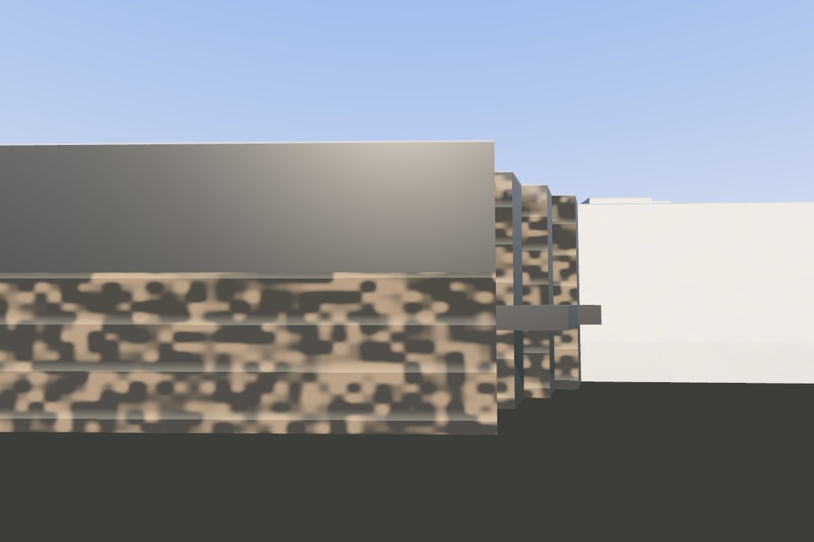
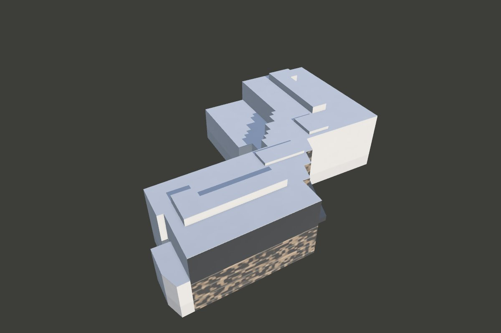
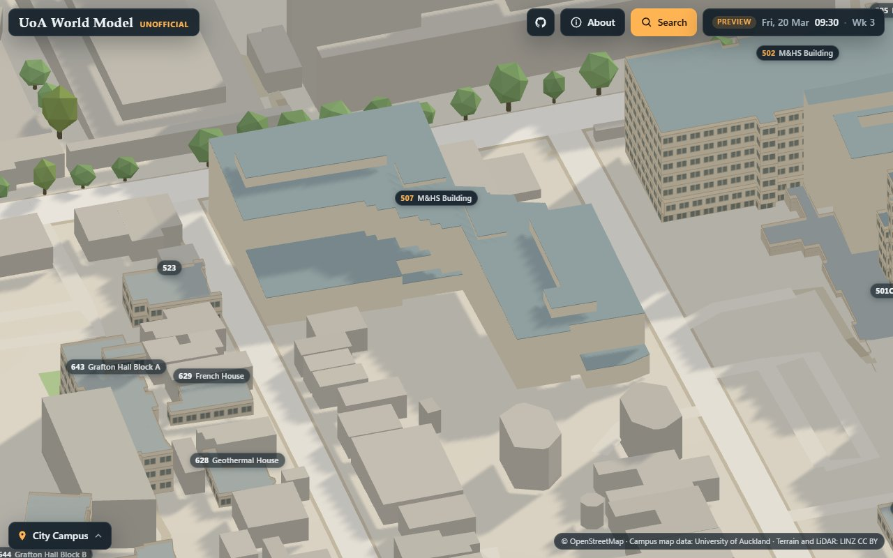
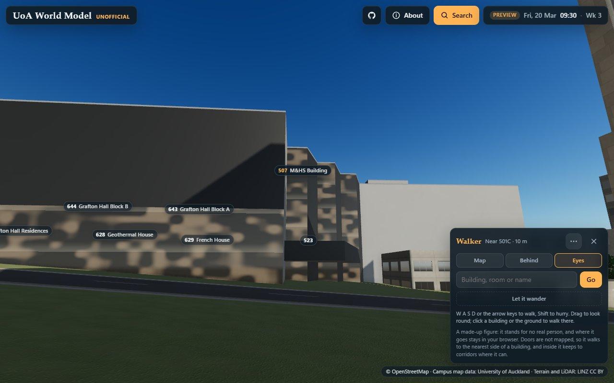

# Landmark: M&HS Building (507), drawn from code

Building 507 of the M&HS Building, University of Auckland, on the Grafton campus: along the street a block of five
storeys, its upper storeys clad in tall near-black metal fins with windows between them over a glazed base two storeys
high; north of it three glazed bays stepping back from the street one behind another, with a canopy over the entrance
at their foot; behind them a block under flat roofs at the same height, with raised parts and a lower part on its south
side. It is drawn in three.js from code alone, sized by the LINZ 2024 LiDAR, and compared with one photograph of the
street face at dusk from across the street (November 2026). The kit it is built with, the pipeline, the viewer and how
to run them are shared by every landmark: [`../README.md`](../README.md).

- Look at it: `http://localhost:8765/landmarks/pipeline/viewer/index.html?landmark=mhs-building-507&view=orbit` with
  the repository root served on port 8765. `site` is true: the site draws it in place of block 507 ("On the site",
  below).
- Run its pipeline: `landmarks/pipeline/run.sh mhs-building-507 [stage ...]`. Its reference is read from
  `refs/photos/` (the config's `"refs": "photos"`), which a fresh clone does not have: `photo`, `refs` (its masks, and
  so the default `all`), `refine`, `compare` and `metrics` need it, `data`, `place` and `topview` do not.
- The rules: [`docs/CONTRACT.md`](docs/CONTRACT.md) and [`docs/ART_BIBLE.md`](docs/ART_BIBLE.md).

## In brief

This is building 507 of the M&HS Building, on the Grafton campus: along the street a block of five
storeys, its upper storeys clad in tall near-black fins over a glazed base two storeys high; north of it three glazed
bays stepping back one behind another, with a canopy over the entrance at their foot; behind them a block under flat
roofs at the same height, with raised parts and a lower part on its south side. Its heights and plans come from the
LiDAR; the underside of the finned storeys and the foot of the canopy's fascia are estimated with the photograph as a
reference. One photograph from across the street to its east-south-east at dusk, about 16 m from the street face;
counted inside the rectangle the model fills on the screen, its silhouette has an IoU of 0.97 in it, and the brightness
of the building is within 5 of the photograph's. From above its outline covers the LiDAR's with an IoU of 0.89, and on 92% of the cells both cover it is within 0.5 m of the LiDAR's height. What the photograph does not show is drawn
plainly.

| | |
| --- | --- |
|  |  |
|  |  |

## The frame

`config/mhs-building-507.json`, `frame`: x north-north-east (minus the axis, the bearing of the building's walls, 198.3
degrees, as 501's and 502's), y up from 68.50 m NZVD2016, the LiDAR's ground at `door`, on the pavement before the
entrance, z east-south-east, toward the street; the centre, the mean of the returns more than 16.5 m over that ground
(the roofs), at x = z = 0. `parts/common.js` gives the building a frame of its own: `u` south-south-west (minus x),
along the street face, and `w` toward the street (z). The frame takes the building's returns more than 9.5 m up only
(`min_above`), so that the low roofs round it and the street's things are left out.

Every height in `parts/common.js` was measured before the door was set, above 68.03 m, the median ground in the first
crop box; `H` moves each on to the door's ground, 0.47 m higher. The frame's thresholds in the config were lowered by
the same 0.47 m, so the measured frame is the one the model was drawn in (0.000 m, 0.000 degrees).

The campus's origin is about 1 km to the north. There the map's true north and NZTM's grid north differ by about a
degree, and the map's metres and the frame's local NZTM metres lie about 18.5 m apart: `place` turns one into the other,
as it does for every landmark.

## Neighbours on the map

- No other landmark comes within 2 m of its outline (building 502, on its own branch, stands 23 m away), so it stands
  on the map's ground at its own door.
- No other block's outline lies within 6 m of 507's. The LiDAR's roofs run up to 4.9 m past the campus map's outline in
  places (the north-west block's west side and its north-west corner, 3.8 to 4.9 m, and the canopy's front and north
  side): the model draws the LiDAR's building. The lower roofs west and north of it (3 to 10 m), outside the outline,
  are other buildings and are not drawn.
- 93.1% of block 507 is under the model above 2.5 m. No other block is under it by half, so `building.also` is empty.

## The reference

One photograph from across the street east-south-east of the south-east block, at dusk, square to its street face: the
face's finned upper storeys over its lit glazed base, cut off by the photograph's left edge; the three glazed bays north
of it, each set back further; the canopy over the entrance at their foot; a large tree and older buildings on the right;
cars parked in the street. The camera fitted to the LiDAR puts the face's parapet and corner and the bays' tops
within 2 px, and the LiDAR's points land on the face, the canopy and the bays: it is 507's. It has no record of its
date. It is kept on the maintainer's computer in `refs/photos/` (gitignored), with the picks on it, its fitted camera,
its level cut and its mask. Nothing of it goes into git, and how it is recorded and credited is for the maintainer to
decide. No Street View photograph is used.

Its camera is fitted by `tools/photo_camera.py`, with its principal point solved (a shifted lens: the face's parapet is
level to the pixel and its verticals upright), to lines and points whose places the LiDAR gives: the street face's
parapet (18.25 m over the provisional ground) and its north-east corner, and the tops of the three glazed bays' fronts
(at w 22.2, 16.3 and 10.75), with two verticals, the camera held 1.6 m over the LiDAR's ground. It stands about 16 m
before the face, square to it, its lens 98.1 degrees across, its principal point at (600, 624) of 1245 x 777: an rms of
0.59 px. A first fit, which took the face along the frame's axis, put the face 2 degrees off its real line (rms 1.38
px). No size is measured from the photograph but the underside of the finned storeys and the foot of the canopy's
fascia (below); it is a reference for the look and the comparison.

## The model (`parts/common.js`)

- **The roofs at 18 m** (18.05; the LiDAR's cells 17.8 to 18.2), as one plan: the south-east block along the street,
  its face from w 31.85 at u 3.6 to 33.2 at u 40 (2 degrees off the frame's axis) to its south end at u 44.3 (46.3 west
  of w 16), its west side over the sunken courtyard 2 degrees off the axis too; the north-west block, u -41.2 to -10 and
  w -43.4 to 4.6, its north side 1.5 degrees off the axis and its south side stepping down to its lower part; and
  between them the three glazed bays, their fronts at w 10.75, 16.3 and 22.2 and their sides slanting 17 degrees.
- **Its faces**: the street face's finned upper storeys (`screenBlack`) from 7.75 m, the underside of their front edge
  (estimated, through the photograph's fitted camera), over its glazed base (`glass`); the bays' fronts glazed and their
  sides near black; every face no photograph shows plain mid grey (`grey`).
- **The raised parts**, each within about 0.5 m of the LiDAR's edges: the south-east block's middle at 20.8 (u 9 to
  41, w 13 to 23.3, an L, its sides 2 degrees off the axis as the street face), the north-west block's strip at 20.8
  (u -30.5 to -21, w -40 to -8, an L), a part at 19.25 south-east of it, and one at 19.1 over the bays' root.
- **The lower parts**: along the north-west block's stepped south side at 9.65 (to u 7.6 and w -42.9),
  one at 5.5 beside it, to the sunken courtyard between the blocks (its ground at -4.1), and the strip at the south-east
  block's south end at 9.35 (u 44.3 to 50.1, from w 18.55, where the pavement's ground begins).
- **The canopy** over the entrance, from the bays out to w 27.75 and on before the third bay, its north side one
  straight line from (u -8.2, w 10.75) to (-2.8, 27.75), as the LiDAR's edge (within 0.15 m): its roof at 5.15
  (the LiDAR's 5.0 to 5.3), its fascia's foot at 3.1 (estimated, through the photograph's camera), near black.
- The roofs `roofGrey`, as the 2023 aerial shows them grey.
- The light: the photograph is at dusk, the face in shade and lit from inside; the model draws no windows and no light
  inside, so the viewer's sun stands square to the face (108 degrees round, 30 up), at an exposure of 1.15: the
  building's luma median 142 against the photograph's 147 (counted in the model's screen box). With the sun behind the
  building, as at dusk, it is 58 to 72.

Silhouette IoU 0.969 in the model's screen box (0.946 in the whole view). The top view: footprint IoU 0.888 (the
LiDAR's 3,643 m² against the model's 3,808, both 3,506; of the 302 m² only the model covers, 209 are roof the LiDAR
sees more than 1.5 m outside the campus map's outline, which the top view leaves out of its own, and 46 have no
return), 92% of the 13,447 cells both cover within 0.5 m (p10/p50/p90 -0.09/0.13/0.26), the highest point 20.34 m
over the door's ground against the LiDAR's 20.45 (p99.9). 498 triangles, 4 draw calls.

## On the map (step 7)

- **The door**: the campus map records no lobby or entrance in 507, and the OpenStreetMap snapshot no entrance within
  150 m, so its entrance is not known from a record. The photograph shows the entrance under the canopy at the bays'
  foot. The config's door is on the pavement 2.25 m out from the canopy's front, where the LiDAR has ground (none under
  the canopy and just before it): u 1.0 and w 30.0 (in the view frame (-1.0, 30.0)); the LiDAR's ground within 1 m, 7
  returns, p50 68.504 m.
- **The map's ground** (its 8 m elevation model) lies 2.14 m above the LiDAR's at the door, and under the model's plans
  from 3.51 m below the door's to 3.81 m above (at the south end).

## On the site

`site` is true: `place` writes `placement.json`, and the site draws the model in place of block 507. 507's entry in
`landmarks/measured/exclusions.json` (the generator's massing of it failed the top-view check, its footprint IoU 0.877
against a limit of 0.9, and 0.878 with the roof forms of the fourth round) has gone; `MASSING.md` notes it in the
Grafton round and the fourth, and `massing.py --campus grafton` leaves it out and writes every other Grafton file as
before.

- **The foot.** Its y = 0 is the map's ground at its door. Its walls go down to FOOT, 4.97 m under the door's ground,
  below the map's ground under every plan: the foot check of `tests/landmarks.test.ts` passes, as does its faces check.
- **While a building is open** its neighbours sink to footprints, and the model gives way to block 507, which sinks on
  its footing, at most 4 m above the lowest ground under it (`updateLandmarks` in `src/scene/CampusScene.ts`), and whose
  footprint shows above the drawn ground on 69% of its cells, by up to 4.2 m (the map's ground falls about 4 m across
  its site).
- **The light form** (the map, and the walker views of the basic tier) draws `glass` as glass and `roofGrey` as roofs,
  as `LIGHT_ROLE` (`src/scene/landmarks.ts`) already says; `grey` and `screenBlack` are walls.
- **Its card** says "estimated:" and the config's `estimated`, which begins "some heights, with a photograph as a
  reference" and goes on with the underside of the street face's finned upper storeys and the foot of the canopy's
  fascia, and the faces no photograph shows.
- **The pictures** in `docs/landmarks/`: `mhs-building-507-front.jpg` and `-above.jpg` are the viewer's renders of the
  model alone, from across the street and from above, with no photograph; `-map.jpg` and `-eyes.jpg` are shots of the
  site built from this branch, the map near it and a walker's eyes across the street from it.

## Not drawn yet

The fins and the windows between them, the glazing's frames, the recessed entrance under the street face's north end
and its column, the things on the roofs; a court in the north-west block under a roof the LiDAR partly sees through
(open or glazed), drawn as roof. The faces no photograph shows (the north-west block's, the south-east block's other
sides) are drawn plainly.
