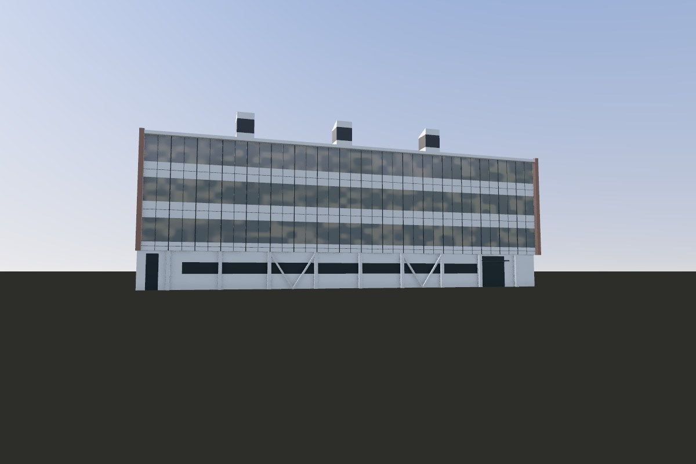
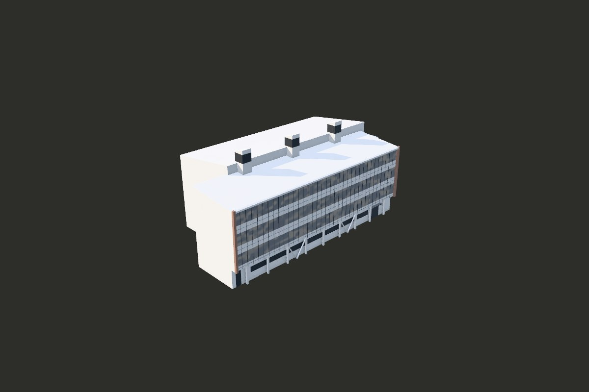
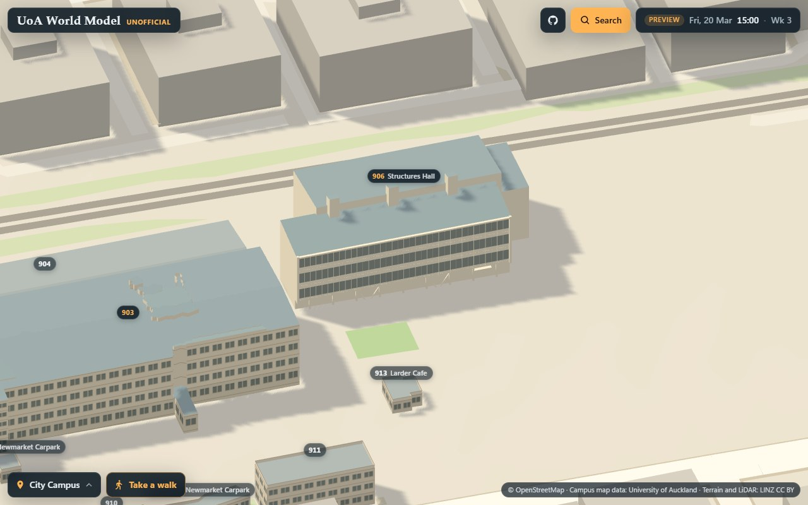
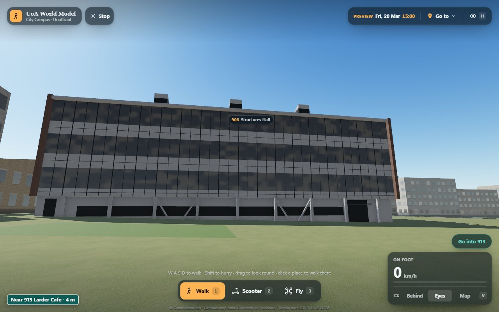

# Landmark: Structures Hall, drawn from code

Structures Hall (906) of the University of Auckland, on the Newmarket campus: two long blocks side by side, each under
a roof of one slope that rises to the line between them, and three square stacks on that line; the south face three
glazed storeys with light bands between them, under a light fascia and between dark frames, over a ground storey set
back behind piers and two Vs of braces; a lower block against the east end. It is drawn in three.js from code alone,
sized by the LINZ 2024 LiDAR, and compared with a photograph of its south face (November 2026). Until now it was a
measured massing (`../MASSING.md`). The kit it is built with, the pipeline, the viewer and how to run them are shared
by every landmark: [`../README.md`](../README.md).

- Look at it: `http://localhost:8765/landmarks/pipeline/viewer/index.html?landmark=structures-hall&view=orbit`
  with the repository root served on port 8765.
- Run its pipeline: `landmarks/pipeline/run.sh structures-hall [stage ...]`. Its reference is read from
  `refs/photos/` (the config's `"refs": "photos"`), which a fresh clone does not have: `photo`, `refs` (its masks, and
  so the default `all`), `refine`, `compare` and `metrics` need it, `data`, `place` and `topview` do not.
- The rules: [`docs/CONTRACT.md`](docs/CONTRACT.md) and [`docs/ART_BIBLE.md`](docs/ART_BIBLE.md).

## In brief

This is Structures Hall (906), on the Newmarket campus, until now a measured massing: two long blocks side by
side, each under a roof of one slope that rises to the line between them, with three square stacks on that line and a
lower block against the east end; the south face three glazed storeys with light bands between them, under a light
fascia and between dark frames, over a ground storey set back behind piers and two Vs of braces. Its heights and plans
come from the LiDAR; the south face's glazing, bands, mullions, fascia and frames, its ground storey and the stacks'
bands are estimated with the photograph as a reference. One photograph of its south face, from an open lot to its
south; counted inside the rectangle the model fills on the screen, its silhouette has an IoU of 0.96 in it, and the
brightness over it is within 4 of the photograph's. From above its outline covers the LiDAR's with an IoU of 0.96, and
on 98% of the cells both cover it is within 0.5 m of the LiDAR's height. What the photograph does not show is drawn
plain.

| | |
| --- | --- |
|  |  |
|  |  |

## The frame

`config/structures-hall.json`, `frame`: x east-south-east (minus the axis, the bearing of the long faces), y up from
52.58 m NZVD2016, the LiDAR's ground at `door`, before the entrance near the south face's east end, z
south-south-west, toward the face the photograph sees; the centre, the mean of the building's returns near the campus
map's ring, at x = z = 0. `parts/common.js` gives the building a frame of its own, `p` along its long faces to the
west-north-west and `q` to the south-south-west, turned 2.28 degrees from the frame's axis: along `p` and `q` the
outermost roof returns of its four faces keep within 0.1 m of a line.

The frame was measured above 52.4 m, the LiDAR's ground at the outline's lowest point; when the config's ground moved
up 0.18 m to the door's, its thresholds were lowered by as much, so that they take the same returns, and
`frame.expected` checks the centre and the axis (0.000 m, 0.000 degrees). The crop box is 80 m round the outline, so
that it takes in the ground where the photograph was taken. The campus map's ring stands about 29 m east-north-east
of the building in the LiDAR's local metres (it is in the map's frame); `place` converts.

## Neighbours on the map

- No other landmark's outline comes within 2 m of its (the nearest, Building 903's, is 8.3 m off), so it stands
  alone on the map's ground at its door (`../README.md`, "Placement").
- The model stands over 98.1% of block 906 and over no other block. `building.also` is empty.
- The nearest buildings are Building 903, 8.3 m to the west, a landmark too, and Building 904, 8.5 m to the north-west,
  a measured massing on the site.

## The reference

One photograph, kept on the maintainer's computer in `refs/photos/` (gitignored), with its picks, its fitted camera,
its level cut and its mask. Nothing of it goes into git, and how it is recorded and credited is for the maintainer to
decide. No Street View photograph is used.

- **The south face**, from an open lot about 64 m south of it (a gravel lot and a car park when the photograph was
  taken, in 2017, before the LiDAR and the aerial; a yard now), on a clear early afternoon with the sun behind the
  building, looking north-north-east and a little up at the whole face: three glazed storeys with light bands between
  them under the fascia, a dark frame at each end, the ground storey set back behind piers and two Vs of braces, and
  the three stacks over the roof edge. Its camera is fitted by `tools/photo_camera.py` to the face's roof edge against
  the sky (the fascia's top at 70.6 m, p90 of the LiDAR's returns along the edge), to both its ends against the sky (p
  32.05 and -22.4, the outermost roof returns), to an upright edge of each stack and to the south-west corners of the
  three stacks' tops and the north-west corners of two, which fall from 77.4 m at their south edge to 76.6 m at their
  north (a plane through each one's returns), held near 1.6 m over the LiDAR's ground. It stands 0.98 m over the
  LiDAR's ground there, its optical axis at bearing 31.0 degrees, looking up 7.5 degrees, through a lens of 49.2
  degrees across (the file's 24 mm on its camera's sensor gives 49.6): an rms of 0.72 px over 104 residuals.
- The stacks' south-east top corners are left out of the fit: the LiDAR's returns from their tops reach about 0.3 m
  further east than the photograph shows them (5.7 to 7.7 px), and with them the fit is 1.34 px.

No size is measured from the photograph but the ones the next section names as estimated; it is a reference for the
look and the comparison.

## The model (`parts/common.js`)

From the LiDAR:

- **The southern block**: p -22.4 to 32.05 and q 2.7 to 16.0 to its roof's outer edges, under a roof of one slope of
  0.1036 a metre (5.9 degrees; a plane through 4,967 returns, rms 0.023 m) from 70.52 m at the south edge up to
  71.90 m at the line between the blocks; the fascia along the south edge to 70.6 m.
- **The northern block**: p -23.95 to 23.05 and q -16.13 to 2.7, under a roof of one slope of 0.1321 a metre (7.5
  degrees; 6,294 returns, rms 0.059 m) from 71.61 m at the north eave up to 74.10 m at the line, 2.2 m over the
  southern block's roof there.
- **The lower block** against the northern one's east end: p -30.95 to -23.95 and q -15.8 to 2.55, flat at 68.05 m.
- **The stacks**: three, about 2.5 m square, 15 m apart on the line between the blocks (q 1.95 to 4.6), their tops
  falling from 77.4 m to 76.6 m.
- **The glass of the south face** at q 15.4 (the returns on the face, 60.5 to 66.5 m), the fascia out to q 16.0 (the
  roof's returns end there), and **the ground storey's wall** set back to q 14.3 (the returns at 52.5 to 55.5 m).
- **The face the northern block turns south** over the southern block's roof has no return between 72.1 and 73.6 m
  along its whole length, as the north face has almost none under its eave: drawn plain, as the block's walls (no
  photograph shows it). West of the northern block the southern block's north wall stands at q 2.1 (the returns on it
  from 53 to 70 m, p50 2.09), and the ground storey's east end is flush with the glazed box over it (p -22.4).
- **The walls' foot**, FOOT, 52.0 m: the ground along the walls (the returns 0.5 to 3 m out) lies from 52.06 m to
  53.06 m.

Estimated through the camera, on those planes: the glazed box's underside at 56.62 m; the light bands at its foot
(56.62 to 57.65 m) and between the storeys (60.46 to 62.37 m and 65.2 to 67.05 m), each with a joint at its middle;
the fascia's underside at 70.2 m; the dark frames, 0.55 m wide, to 70.8 m (the LiDAR's highest returns at the west
end, 70.83 m); 36 equal bays of mullions between the frames (the photograph's mullions fall 1.47 to 1.52 m apart), a
heavier one every second bay; the stacks' light bands to 76.43 m and dark louvres to 74.34 m; on the ground storey a
band of dark windows (53.9 to 55.3 m), a door at the west end, a glazed entrance under a thin canopy near the east end,
nine piers 0.4 m wide on every fourth bay's line from the second (the photograph's nine within 0.3 m of them) and two
Vs of braces from the piers' tops to the ground in the bays from line 10 to 14 and from 22 to 26. The north face, the
ends and the lower block, which no photograph shows, are drawn plain.

## The light

The photograph is taken in the early afternoon of a clear day in late May, when the sun stands behind the building
and the south face is in its own shade, so the viewer's sun stands where it stood then, to the north-north-west (325
degrees round, 27 up), at its usual strength (8), with a strong sky (3.4, against 2.25), at an exposure of 0.85 (the
config's `light`): over the model's screen box the luma (p50) 119 against the photograph's 123.

## On the map (step 7)

- **The door**: the campus map records no entrance in 906. The config's door is before the glazed entrance under the
  canopy near the south face's east end, 1.7 m out from it, p -15.3 and q 16.0 (in the view frame (15.92, 15.38)); the
  LiDAR's ground within 1 m, 10 returns, p50 52.576 m.
- **The map's ground** (its 8 m elevation model) is 56.38 m at the door, 3.80 m over the LiDAR's, and from 0.28 m
  under to 1.20 m over it under the walls' corners; the model stands its y = 0 on it at the door.

## On the site

`site` is true: `place` writes `placement.json`, and the site draws the model in place of block 906. Its measured
massing's data file, `landmarks/measured/buildings/906.json`, has gone: a run of `massing.py` over the Newmarket
campus leaves it out, as it does every landmark on the site, and writes every other file as before. `MASSING.md`
notes it.

- **The foot.** It stands alone, its y = 0 on the map's ground at its door. Its walls go down to FOOT, 0.58 m under
  the door's ground, under the map's ground at every corner of the walls (the lowest, 0.28 m under the door's, at the
  lower block's south-east corner; 0.30 m to spare). Toward the west end the map's ground rises up to 1.20 m over the
  door's, so there the ground storey stands partly in it.
- **Its neighbour.** Building 903, 8.3 m to the west and a landmark too, stands on the map's ground at its own door,
  5.01 m over the LiDAR's ground there, where this model stands 3.80 m over the LiDAR's: so on the map 903's roof,
  about 0.4 m under this one's south edge in the LiDAR, stands about 0.8 m over it.
- **While a building is open** its neighbours sink to footprints, and the model gives way to block 906, which sinks on
  its footing (`updateLandmarks` in `src/scene/CampusScene.ts`).
- **The light form** (the map, and the walker views of the basic tier) draws `glassPale` as glass and `roofPale` as a
  roof, as `LIGHT_ROLE` (`src/scene/landmarks.ts`) already says; `claddingPale`, `screenBlack` and `finBrown` are walls.
- **Its card** says "estimated:" and the config's `estimated`.
- **The pictures** in `docs/landmarks/`: `structures-hall-front.jpg` and `-above.jpg` are the viewer's renders of the
  model alone, from the lot to its south and from above, with no photograph; `-map.jpg` and `-eyes.jpg` are shots of
  the site built from this branch: the map near it, and a walker's eyes in the lot to its south.

## Not drawn yet

The glazed storeys' opening lights and the panels among the glass, the doors themselves, the trees before the south
face, anything on the north face, the ends and the lower block, and the yard round it.
