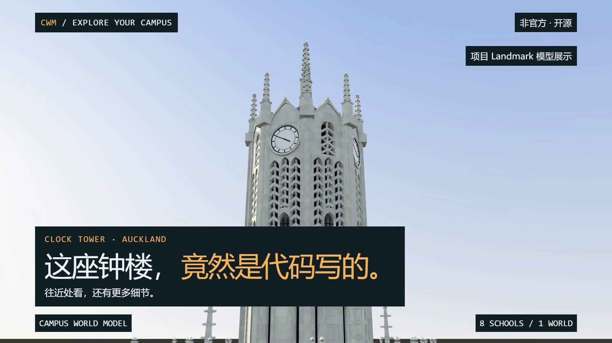

# Campus World Model film

A 46-second Chinese trailer for the **unofficial**, non-commercial campus maps. The portrait
version is 1080 × 1920; the landscape version is 1920 × 1080. Both use 30 frames a second.
The film shows eight schools, Walk / Scooter / Fly, the Clock Tower and other Auckland landmarks,
an Auckland room, and the map at night. It ends with the site's address.

The Clock Tower gets the opening and the main architectural sequence. Its shots come from the
repository's landmark viewer and say so on screen. Walker and map shots come from the local
application. No stock footage, reference photograph, new campus data or test timetable is used.
The school overview says that floors and rooms are available for Auckland only. The unmerged
book game is absent.



Review frames: [portrait](previews/review-portrait.jpg), [landscape](previews/review-landscape.jpg).
These are sampled from the exported movies, including every scene and the closing hold.

## Deliverables

Local exports, kept out of git:

- `renders/Campus-World-Model-portrait.mp4`
- `renders/Campus-World-Model-landscape.mp4`
- `renders/cover-portrait.jpg`
- `renders/cover-landscape.jpg`

The editable source is `index.html` for portrait and `versions/landscape.html` for landscape.
`compose.mjs` writes both from the same script. `DESIGN.md` defines their look and motion.
`storyboard.json` gives the shot times and text. No site code or published data changes.

## Rebuild

Use the repository's installed dependencies, Node 22 or newer, Chrome, FFmpeg and FFprobe.
The pinned authoring CLI is HyperFrames 0.9.41. It is separate from the site's dependencies.
The local render uses Microsoft YaHei and Consolas from Windows. Those fonts are not
redistributed. Another machine must have them installed or supply its own licensed fonts.

From the repository root, start a local app on an unused port:

```powershell
node node_modules/vite/bin/vite.js --host 127.0.0.1 --port 5373
```

In another terminal, from this folder:

```powershell
$env:HYPERFRAMES_FFMPEG_PATH = (Get-Command ffmpeg).Source
$env:HYPERFRAMES_FFPROBE_PATH = (Get-Command ffprobe).Source
$env:PROMO_SOURCE_COMMIT = (git rev-parse HEAD)
npx.cmd --yes hyperframes@0.9.41 --version
node capture.mjs
node prepare.mjs
node compose.mjs
node stage-landscape.mjs
npm.cmd run check
npm.cmd run check:landscape
npm.cmd run render
npm.cmd run render:landscape
npm.cmd run deliver
```

`capture.mjs` starts the local landmark viewer on 8766. Both servers bind to 127.0.0.1. The
capture browser blocks every remote request. Set `PROMO_APP_URL` for another local app port.
`--stills` makes quick framing checks; `--only=walk,scooter,fly` and `--portrait` or `--landscape`
repeat a subset. The browser advances its clock by a frame at a time for the walking clips.
The app's real movement and collision rules still apply. No snapshot is fetched or rebuilt.

`node deliver.mjs --save-previews` also updates the small review images committed with this
source. The movies, audio and full capture assets stay local.

`prepare.mjs` copies the existing render images, creates the original instrumental score,
and takes GSAP 3.15.0 from the pinned CLI's local vendor directory. Set `PROMO_GSAP_PATH` to
that local file on a machine with a different cache layout. No remote media is used at render
time. `stage-landscape.mjs` makes a local copy under `.hyperframes/landscape` so that the checker
can inspect its own `index.html`.

For Studio, run `npm.cmd run dev`. Use the project URL reported by the CLI, with
`/#project/campus-explorer`. The source HTML is not the Studio preview.

## Checks

Run the HyperFrames check on both versions and open snapshots at each shot's middle and at
the transitions. Check the exported MP4s too. Local reports, captures, audio and exports are
ignored. The current checker warns that system fonts are local, that some timed overlays
contain several elements, and that the closing address is held still for reading. These are
intentional. A crossfade briefly places the incoming scene over the outgoing text; each
outgoing overlay ends after the transition. Layout and contrast must still pass.

The older skill's standalone animation-map script imports `@hyperframes/producer`, which the
standalone CLI does not expose. Use the current check's motion pass and the reviewed animation
map from the local compatibility adapter for this session. That adapter does not change the
composition or install a site dependency.

## Sources and rights

The existing project's MIT licence covers the video source and the new procedural soundtrack.
The soundtrack contains no sampled recording. The existing campus and landmark render images
are project renders; reference photographs are never included. Data rights still apply:

- Map data: © [OpenStreetMap contributors](https://www.openstreetmap.org/copyright), ODbL 1.0.
- Terrain: LINZ, [CC BY 3.0 NZ](https://creativecommons.org/licenses/by/3.0/nz/).
- Landmark measurements: Auckland LiDAR 2024 and LINZ aerial imagery,
  [CC BY 4.0](https://creativecommons.org/licenses/by/4.0/).
- Walker body: Quaternius, CC0 1.0, as credited in the repository README.
- GSAP: the licence distributed with the pinned HyperFrames CLI's vendor copy.

See [the repository's source table](../../docs/data-sources.md), [NOTICE](../../NOTICE), and
the site's [About](https://campusworldmodel.com/#about) for the full credits, precision and
limits. The Clock Tower's dimensions use LiDAR; some details are estimates. The other seven
schools currently show buildings. No public class timetable is claimed.

## Suggested post

这座钟楼，竟然是代码写的。现在，你可以在浏览器里探索新西兰八所公立大学：步行、骑滑板车，
或者切换无人机飞过屋顶。走近奥大的 Clock Tower，看看尖塔、拱窗和石材纹理。
你会先逛哪一所？https://campusworldmodel.com/

非官方开源项目。奥大支持楼层与教室查询，其余学校当前展示建筑。建筑细节含估计。
数据与许可：https://campusworldmodel.com/#about 。地图 © OpenStreetMap contributors
（https://www.openstreetmap.org/copyright）；LINZ 地形 CC BY 3.0 NZ，LiDAR CC BY 4.0。

#新西兰留学 #校园探索 #开源项目 #三维地图 #奥克兰大学
